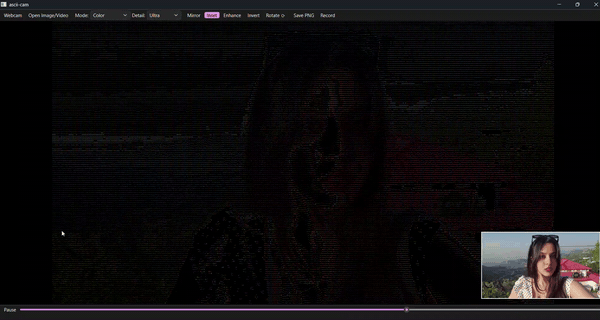

<div align="center">

# 🎥 ASCII Art Camera ✨

**Turn your webcam, screen, images, and videos into living ASCII art — in real time.**

A polished, multithreaded C++ desktop app built with **OpenCV** + **Qt**, featuring
real edge-directional rendering, adaptive detail, and a picture-in-picture preview.


<br/>



▶️ **[Watch the full-quality recording](assets/demo.mp4)**

🌐 **[Live project page](https://ruchi2117.github.io/ASCII-Art/)**

[](https://render.com/deploy?repo=https://github.com/Ruchi2117/ASCII-Art)

</div>

---

## 📑 Table of Contents

- [Features](#-features)
- [Tech Stack](#-tech-stack)
- [Setup](#-setup)
- [Usage](#-usage)
- [Keyboard Shortcuts](#️-keyboard-shortcuts)
- [Project Structure](#️-project-structure)
- [How It Works](#-how-it-works)
- [Roadmap](#️-roadmap)
- [Author](#-author)
- [License](#-license)

---

## ✨ Features

- 🎨 **Multiple render modes** — Luminance, Color (truecolor), and real **Edge-directional** ASCII
- 🧠 **Real edge detection** — a Sobel gradient picks `|` `/` `-` `\` glyphs by edge *direction* (not a fake "denser ramp")
- 🔍 **Adjustable detail** — Low → **Ultra** (near per-pixel), with a fine 70-level ramp for smooth tone
- 🪄 **Image enhancement** — adaptive local contrast (CLAHE) + unsharp so features stay crisp
- 📷 **Multiple inputs** — live webcam, or upload any **image / video** (shown faithfully, un-edited)
- 🖼️ **Movable picture-in-picture** — drag the original preview; it snaps to corners and matches the source aspect ratio
- ⏯️ **Video transport** — play/pause and a **scrub bar** to seek back and forth
- 💾 **Export** — save a high-resolution **PNG** snapshot or record an **MP4**
- 🔄 **Rotate / mirror / invert** — full control over orientation and tone
- ⚡ **Buttery UI** — conversion runs on a background worker thread, so the interface never stalls

## 🧩 Tech Stack

| Layer | Technology |
|-------|-----------|
| **Language** | C++20 |
| **GUI** | Qt 6 (Widgets) |
| **Computer vision** | OpenCV 4 (capture, resize, Sobel, CLAHE, video I/O) |
| **Build system** | CMake 3.20+ with Ninja |
| **Testing** | Catch2 v3 (21 unit tests, fetched via CMake FetchContent) |
| **Compiler / toolchain** | GCC (MSYS2 UCRT64) — also builds with MSVC/Clang |
| **Threading** | C++ standard library (`std::thread`, `std::mutex`, `std::condition_variable`) |

## 📦 Setup

### Prerequisites

- A **C++20** compiler, **CMake 3.20+**, **OpenCV 4**, and **Qt 6**.
- On Windows, the simplest way to get all of these is [MSYS2](https://www.msys2.org).

### 1. Install the toolchain (Windows / MSYS2)

Open the **MSYS2 UCRT64** shell and run:

```bash
pacman -Syu        # update once (may ask you to reopen the shell)
pacman -S --needed \
  mingw-w64-ucrt-x86_64-gcc \
  mingw-w64-ucrt-x86_64-cmake \
  mingw-w64-ucrt-x86_64-ninja \
  mingw-w64-ucrt-x86_64-opencv \
  mingw-w64-ucrt-x86_64-qt6-base \
  git
```

> **Linux/macOS:** install the equivalents via your package manager
> (`build-essential`/Xcode CLT, `cmake`, `ninja`, `opencv`, `qt6`), then use the
> same CMake commands below.

### 2. Clone

```bash
git clone https://github.com/Ruchi2117/ASCII-Art.git
cd ASCII-Art
```

### 3. Build

```bash
cmake -G Ninja -S . -B build
cmake --build build
```

### 4. Test (optional)

```bash
ctest --test-dir build --output-on-failure   # 21 unit tests
```

### 5. Run

```bash
./build/src/gui/ascii_cam_gui       # launch the GUI (webcam by default)
```

## 🚀 Usage

**Browser build** — open the live project page to run the deployable camera version
directly in a modern browser. It uses the local webcam through `getUserMedia`, renders
ASCII on Canvas, and can be hosted as a static site.

When testing the browser build locally, serve `docs/` from `localhost` or use the
hosted HTTPS page. Browsers block camera access on insecure origins, which makes
the Start Camera button fail before a webcam prompt can appear.

**Render deploy** — this repo includes `render.yaml`, so you can use the Deploy to
Render button above. Manual Render settings are:

```text
Service type: Static Site
Build Command: echo "Static site ready"
Publish Directory: ./docs
```

**GUI** — launch and use the toolbar (source, mode, detail, inset, export) or the
keyboard shortcuts below. Open an image/video with **Open Image/Video…**; a
scrub bar appears for videos.

```bash
./build/src/gui/ascii_cam_gui                 # webcam
./build/src/gui/ascii_cam_gui path/to/clip.mp4  # open a file directly
```

**Terminal tool** — a headless image/video → ASCII renderer:

```bash
./build/src/app/ascii_cam --file assets/test.png --width 100   # image → ASCII
./build/src/app/ascii_cam --file assets/test.png --edge        # edge mode
./build/src/app/ascii_cam                                       # live webcam FPS
```

## ⌨️ Keyboard Shortcuts

| Key | Action | Key | Action |
|:---:|:-------|:---:|:-------|
| `Space` | Save PNG snapshot | `V` | Invert |
| `1` `2` `3` | Luminance / Color / Edge | `T` | Rotate 90° |
| `M` | Mirror | `R` | Record video |
| `I` | Toggle inset | `F` | Fullscreen |
| `E` | Enhance | | |

## 🗂️ Project Structure

```
ASCII-Art/
├── CMakeLists.txt              # top-level build; finds OpenCV/Qt, wires targets
├── README.md  ·  LICENSE  ·  .clang-format
├── assets/                     # demo media + sample inputs
│   ├── demo.gif / demo.mp4
│   └── test.png / heart.png
├── src/
│   ├── core/
│   │   └── LatestFrameBuffer.h # generic thread-safe single-slot mailbox
│   ├── engine/                 # pure logic — no OpenCV/Qt, fully unit-tested
│   │   ├── RenderConfig.h       # all rendering parameters (single source of truth)
│   │   ├── AsciiFrame.h         # grid of UTF-8 glyph + color cells
│   │   ├── Luminance.h          # gamma-correct luminance, tone map, ramp index
│   │   ├── Ramp.h  ·  Color.h  ·  EmojiPalette.h
│   │   └── GlyphMapper.h        # Luminance / Edge / Emoji strategies
│   ├── pipeline/
│   │   └── FrameConverter.*     # OpenCV bridge: frame → AsciiFrame
│   ├── capture/
│   │   ├── IFrameSource.h       # source interface
│   │   ├── CameraCapture.*      # threaded webcam capture
│   │   └── FileSource.*         # image + video (seek/pause) source
│   ├── app/
│   │   └── main.cpp             # headless terminal tool
│   └── gui/                     # Qt application
│       ├── main.cpp  ·  MainWindow.*
│       ├── AsciiView.*          # widget: paints ASCII + draggable inset
│       └── AsciiRenderer.*      # shared paint + PNG/video frame rendering
└── tests/                      # Catch2 unit tests
    ├── test_latest_frame_buffer.cpp
    ├── test_luminance.cpp
    ├── test_color.cpp
    └── test_glyph_mapper.cpp
```

## 🔧 How It Works

The pure engine is isolated from all I/O, so its logic builds and is
**unit-tested without OpenCV or Qt**. Everything flows through a
**3-stage threaded pipeline** that keeps the UI smooth:

```
[capture thread]      grab frames from webcam / file
        │  (newest-frame-wins buffer — never backs up)
        ▼
[conversion worker]   downsample → block-average → luminance / edge / color
        │             → map each cell to a glyph → AsciiFrame
        ▼
[UI thread]           paint the ASCII grid + inset, handle input & export
```

Because heavy work (downscaling, CLAHE, Sobel, glyph mapping) happens off the UI
thread, the interface stays responsive even at high detail. The buffers keep only
the most recent frame, so a slow stage drops frames instead of building lag.

## 🗺️ Roadmap

- [ ] Finger-heart gesture detection (hand-landmark model) → 💖 fill
- [ ] Themed color→emoji mode
- [ ] Glyph-atlas renderer for frame-perfect Ultra detail
- [ ] Braille rendering & a WebGL web port

## 👤 Author

Built and maintained by [Ruchi2117](https://github.com/Ruchi2117).

## 📄 License

MIT — see [LICENSE](LICENSE).
